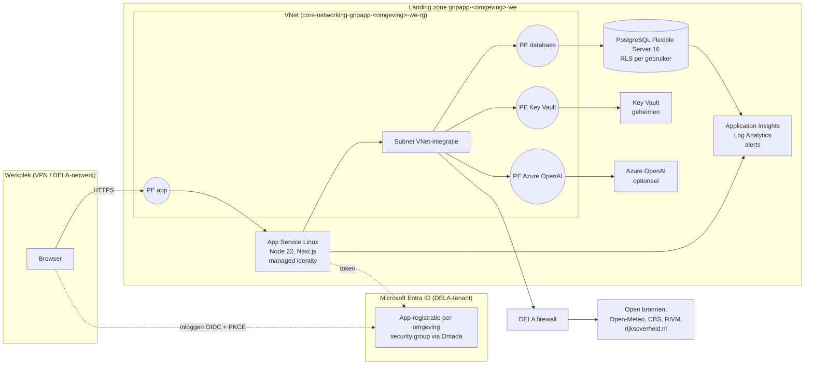

# Solution design GRIP Regelplekken

*Concept voor de architectuurreview. Status: proof of concept, op weg naar de landing zone van DELA.*

## 1. Doel en scope

GRIP is de planningsapp voor de regelplekken van de uitvaartverzorgers en de nabestaandendesk (NBD). Eén app voor de keten voorspellen → roosteren → bijvoorspellen → bijsturen → meldingen verdelen, met verlof, ruilen en vaststellen van roosters. Hij vervangt de vorige GRIP (maandrooster, NBD, UVD). Wat elk onderdeel doet: [werking.md](werking.md).

| | |
|---|---|
| Gebruikers | Planners, regiomanagers, medewerkers (uitvaartverzorgers, uitvaartleiders, NBD), beheerders. Enkele honderden accounts, tientallen tegelijk. |
| Beschikbaarheid | Kantoortijden en de ochtend (verdelen om 07:00, dagelijkse voorspelling om 06:00). Geen 24/7-proces; bij uitval kan de planning een dag terugvallen op de laatste stand. |
| Beheer | Voorstel: MUG / Uitvaartdiensten (functioneel), IT (technisch). Nog te bevestigen. |

## 2. Architectuur

| Onderdeel | Dienst | Opmerking |
|---|---|---|
| Web en API | Azure App Service (Linux, Node 22), Next.js 15 | Eén proces voor pagina's en API. Rekenwerk (voorspelling, roosteren, verdelen) draait grotendeels in de browser (web worker). |
| Database | Azure Database for PostgreSQL Flexible Server 16 | Rechten per gebruiker in de database zelf (row level security). De app zet het schema zelf neer en werkt het bij. |
| Geheimen | Azure Key Vault (RBAC) | De app leest ze met een user-assigned managed identity. |
| Dagelijkse taak | In de app (`GRIP_DAGTAAK=intern`) | Elke ochtend na 06:00: bronnen verversen en een nieuwe voorspelling. De database legt vast wie de taak doet, ook met meer instanties. |
| Live bijwerken | In de app en de database | Server-sent events en `LISTEN/NOTIFY`; geen aparte dienst. |
| AI-roosterassistent | Azure OpenAI (optioneel) | Data Zone Standard (verwerking binnen de EU), inloggen met managed identity. Zonder: alleen de eigen controle. |
| Monitoring | Application Insights, Log Analytics, Azure Monitor alerts | Zie § 7. |
| Infrastructuur | Bicep (`infra/`) | Eén omgeving per abonnement; parameters per omgeving. |
| Uitrol | Azure DevOps (`azure-pipelines.yml`) | Zie § 6. |

## 3. Netwerk

- **Geen publieke toegang.** App, database, Key Vault en Azure OpenAI hebben elk een private endpoint in het subnet van de landing zone; publieke toegang staat uit.
- **Inkomend**: alleen via het DELA-netwerk (VPN). Het interne adres (bijvoorbeeld `grip.dela.nl`) en het certificaat regelt DELA. *Open punt.*
- **Uitgaand**: via de VNet-integratie van de app en de firewall van DELA (`vnetRouteAllEnabled`). Nodig:

| Doel | Waarvoor | Verplicht |
|---|---|---|
| `login.microsoftonline.com` | Inloggen (Entra ID) | ja |
| `api.open-meteo.com`, `archive-api.open-meteo.com`, `air-quality-api.open-meteo.com`, `seasonal-api.open-meteo.com` (met een zakelijke sleutel: `customer-*.open-meteo.com`) | Weer, luchtkwaliteit en seizoensverwachting voor de voorspelling | ja |
| `opendata.cbs.nl` | Landelijke sterfte | ja |
| `data.rivm.nl` | Rioolwater (COVID) | ja |
| `opendata.rijksoverheid.nl` | Schoolvakanties | ja |
| `graph.microsoft.com` | Alleen als GRIP zelf gasten uitnodigt; bij DELA uit | nee |
| `routes.googleapis.com` of `api.tomtom.com` | Alleen met live reistijd (kost geld); standaard uit | nee |

- **DNS**: de private DNS-zones (privatelink) regelt DELA centraal; de Bicep kan ze ook koppelen als dat nodig is.

## 4. Identiteit en toegang

- **Inloggen**: OpenID Connect met PKCE tegen de Entra ID van DELA, alleen accounts uit de eigen organisatie. Eén app-registratie per omgeving, alleen de scopes `openid`, `profile` en `email`.
- **Wie binnenkomt**: *Assignment required* op de enterprise app, met een security group die via Omada wordt beheerd (voordeur en achterdeur via Omada). GRIP nodigt bij DELA zelf geen gasten uit (gebouwd met `build:dela`).
- **Wat iemand mag**: rol (medewerker, planner, regiomanager, beheerder) en regio's in GRIP zelf, door de beheerder. De database dwingt dat af (RLS); de app controleert het daarnaast bij elke aanvraag. Maken, adviseren en goedkeuren van roosters zijn gescheiden rollen.
- **Sessie**: een verzegeld, versleuteld cookie (HttpOnly, Secure, SameSite), 12 uur geldig.
- **Diensten onderling**: managed identity (Key Vault, Azure OpenAI). De database met een wachtwoord uit de Key Vault; Entra-authenticatie voor Postgres is een mogelijke vervolgstap.
- **Beheer van Azure**: via de service connections (workload identity federation, geen geheimen) en CyberArk voor personen.

## 5. Gegevens

| Gegevens | Voorbeelden | Gevoeligheid |
|---|---|---|
| Medewerkers | Naam, werk-e-mailadres, regio, functie, contracturen, woonplaats als postcode (4 cijfers) | Persoonsgegevens |
| Rooster en verlof | Diensten, verlof, ruilen, voorkeuren en wensen | Persoonsgegevens |
| Ziekte | Alleen dat iemand ziek is en van wanneer tot wanneer, zonder reden | Persoonsgegevens; extra zorgvuldig (AVG) |
| Meldingen | Aantallen per regio en dag; bij verdelen alleen de postcode (4 cijfers), regio en tijd, geen naam of adres van de familie | Bedrijfsgegevens |
| Open bronnen | Weer, sterfte, rioolwater, schoolvakanties | Openbaar |

- Alles staat in Azure West-Europa. Back-ups: 7 dagen (prd 35), terug te zetten naar elk moment.
- Naar Azure OpenAI gaan **geen namen**: medewerkers heten in de vraag M1, M2, enzovoort. Verwerking binnen de EU; Microsoft gebruikt de gegevens niet voor training.
- Bewaartermijnen en de verwerkersrol: *open punt voor de ISRA*.

## 6. OTAP en uitrol

| Omgeving | Abonnement | Uitrol |
|---|---|---|
| dev | DELAGROUP - gripapp dev we | Na elke push naar `main`, na alle controles |
| tst | DELAGROUP - gripapp tst we | Na dev; daarna ook de security-scan van de draaiende app |
| acc | DELAGROUP - gripapp acc we | Na tst, met akkoord |
| prd | DELAGROUP - gripapp prd we | Na acc, alleen vanaf `main`, met akkoord |

Controles bij elke wijziging, ook bij een pull request:

- lint, typecheck en ruim 500 unit-tests, ook op een echte Postgres (rechten per rol, gelijktijdig opslaan);
- end-to-end-tests in de browser, lokaal en zoals in Azure (met een nagebootste Entra ID);
- security: kwetsbare afhankelijkheden (`npm audit`), geheimen in code en geschiedenis (gitleaks), static code analysis (Semgrep, OWASP Top 10), Bicep-lint;
- na elke uitrol een rooktest; op tst de OWASP ZAP baseline-scan.

Niemand zet handmatig iets neer: alles gaat via de pipeline, en elke omgeving krijgt hetzelfde pakket.

## 7. Monitoring en beheer

- **Application Insights** (automatisch via App Service): aanvragen, fouten, snelheid, afhankelijkheden.
- **Log Analytics**: logboeken van app, database en Key Vault.
- **Gezondheidscheck** `/api/gezond`: app én database; App Service vervangt een ongezonde instantie.
- **Meldingen**: serverfouten (5xx), gezondheidscheck faalt, dagelijkse voorspelling mislukt.
- **Versie**: `/api/versie` geeft de commit die draait.
- **Back-up en herstel**: point-in-time restore van de database; de app is stateless en opnieuw uit te rollen.

## 8. Beveiliging in de app

- HTTPS verplicht, TLS 1.2+, HSTS, `X-Frame-Options: DENY`, `nosniff`, strikte referrer en permissions policy.
- Elke databaseaanvraag met de rechten van wie is ingelogd; alleen tabellen en functies uit een vaste lijst, waarden als parameter.
- Wijzigende aanvragen alleen vanaf de eigen site (bescherming tegen CSRF).
- Limieten op de dure routes (AI, bronnen), per gebruiker en in totaal.
- Geen publiceren met gebruikersnaam en wachtwoord (FTP en SCM uit).

## 9. Open punten

1. **Netwerk**: namen van VNet en subnets per omgeving; intern adres en certificaat; welke uitgaande adressen (tabel § 3) de firewall doorlaat.
2. **Agent pool in het VNet** voor uitrol en rooktest.
3. **Entra ID**: app-registratie per omgeving, de security group en Omada; hoe externen (bijvoorbeeld zzp'ers) toegang krijgen.
4. **Azure OpenAI**: is het toegestaan, en met welk model en welke regio?
5. **Policies**: welke Azure Policies extra eisen stellen (bijvoorbeeld diagnostische instellingen, tags, Entra-authenticatie voor Postgres).
6. **Bron van de code**: Azure DevOps of GitHub.
7. **Overstap**: gegevens van de huidige omgeving (gripapp.nl) overzetten en die omgeving daarna uitzetten.
8. **Beheer, CMDB en ISRA**: beheerteam, eigenaar, classificatie, bewaartermijnen.
9. **Kleinere punten**: 8 meldingen van *moderate* niveau in ontwikkeltools (alleen bij het bouwen, niet in productie); bijwerken met de volgende grote versie van Vitest en ESLint.
